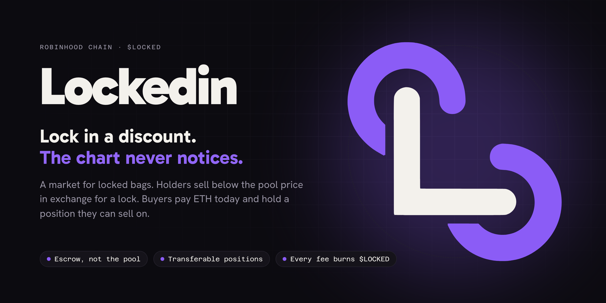
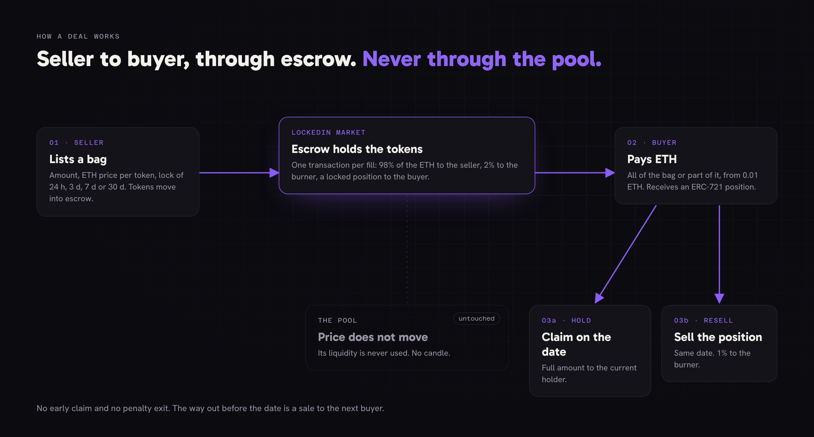
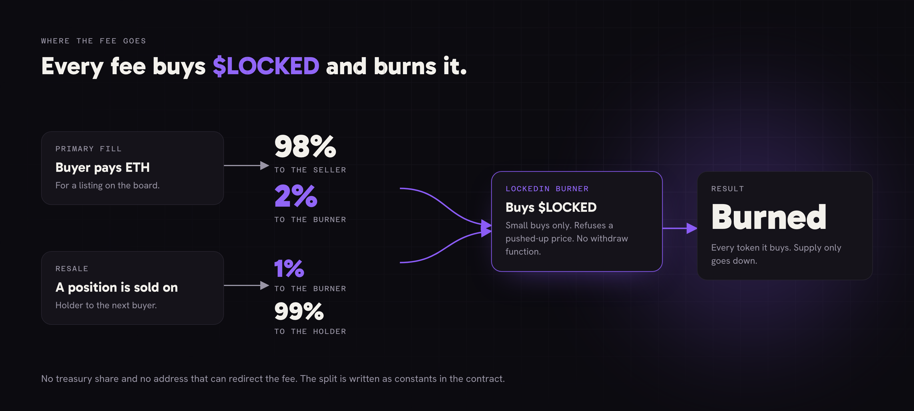
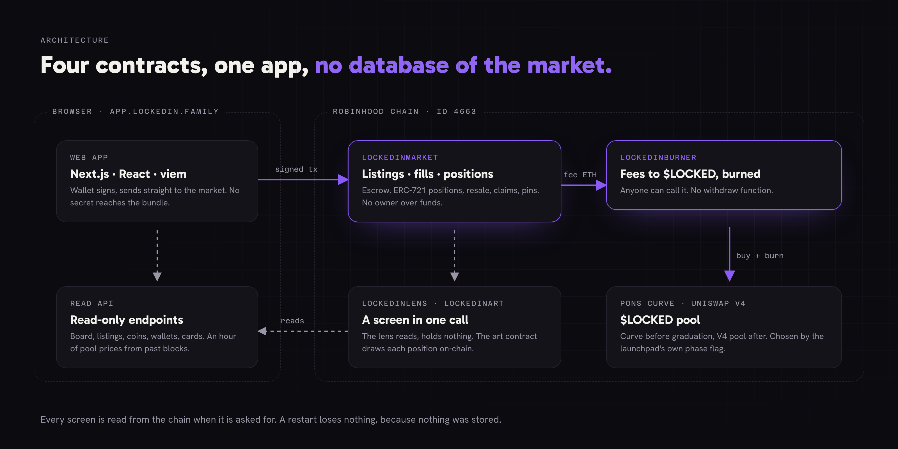
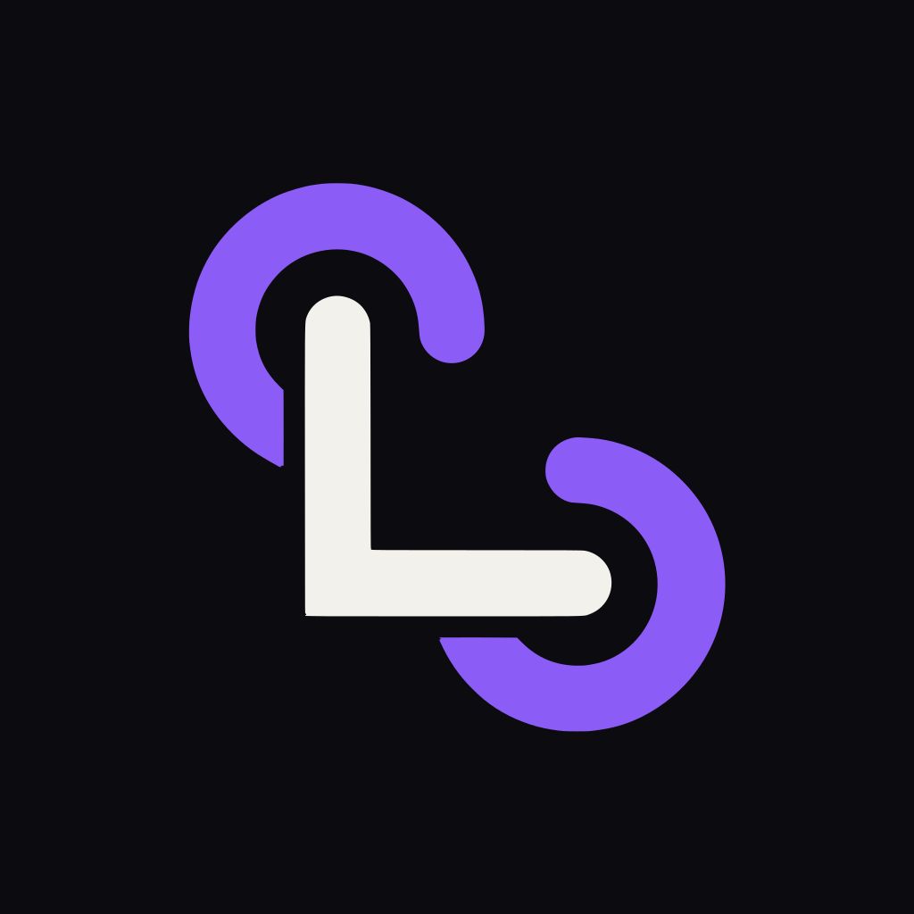

<p align="center">
  
</p>

<p align="center">
  <a href="https://lockedin.family"><b>Website</b></a> ·
  <a href="https://lockedin.family/docs"><b>Docs</b></a> ·
  <a href="https://x.com/lockedin_RH"><b>X</b></a> ·
  <a href="https://app.lockedin.family"><b>App</b></a>
</p>

<p align="center">
  
  
  
  
  
  
</p>

---

**Lockedin** is a market on Robinhood Chain for locked bags. A holder sells tokens below the pool price in exchange for a lock. The buyer pays ETH today and receives a locked position that unlocks on a set date and can itself be sold on. The tokens move from wallet to wallet through escrow, never through the pool, and every fee buys **$LOCKED** and burns it.

> [!NOTE]
> **Status: pre-launch market.** The $LOCKED token address is `0xe4cf8418a6ee2dd37ac39f22ae33a84bfcbf987f`. The market contracts are written, reviewed and rehearsed on a fork of the live chain, and are not deployed on mainnet yet. Their addresses will be published here, on the website and on X at the same time. Any address shared elsewhere is not ours.

## Contents

- [Why Lockedin](#why-lockedin)
- [How a deal works](#how-a-deal-works)
- [The discount](#the-discount)
- [Where the fee goes](#where-the-fee-goes)
- [$LOCKED](#locked)
- [Architecture](#architecture)
- [What the contracts cannot do](#what-the-contracts-cannot-do)
- [Deployments](#deployments)
- [Roadmap](#roadmap)
- [Risks](#risks)

## Why Lockedin

Robinhood Chain coins trade in thin pools. A bag worth a few ETH is often bigger than the pool it would be sold into.

- A holder who sells a large bag at market eats the slippage and hands every other holder a red candle.
- A buyer who wants size meets the same pool from the other side: the price runs before the order fills.
- Token lockers ask holders to give up liquidity and offer nothing on day one. A locked position there cannot change hands, so the only way out is a penalty, and the tokens reach the pool anyway.
- Private deals happen in direct messages: no escrow, no public price, and one side always sends first.

**The thesis:** time is worth money, and a market can price it. A seller who takes ETH today accepts a lower price. A buyer who can wait pays less. The tokens sit in escrow until the date, so the sale never reaches the pool, and the position stays liquid because it can be sold on.

| | Token lockers | Lockedin |
|---|---|---|
| Day one | You lock and get nothing up front | The lock is the price of a discount you get at the fill |
| Reward | Only if someone else leaves early | Fixed at the fill, depends on no one else |
| Getting out | Penalty of up to 25%, tokens hit the pool | Sell the position at your own price |
| Lock length | Months or years | 24 hours, 3 days, 7 days or 30 days |
| Cold start | Empty until many people lock | One seller with one bag opens a market |

## How a deal works

<p align="center"></p>

1. **The seller lists a bag:** an amount, a price in ETH per token and a lock length. The tokens move into escrow the moment the listing is created.
2. **A buyer pays ETH** for all of the bag or part of it.
3. **In the same transaction** the seller receives the ETH less the 2% fee, and the buyer receives a locked position (ERC-721).
4. **The buyer either waits** for the date and claims the tokens, **or sells the position** to someone else. The unlock date does not change on a resale.

The pool takes part in none of these steps. Its price does not move and its liquidity is not used.

### A listing

| Field | Rule |
|---|---|
| Token | Any coin launched through Pons, checked against the launch factory on-chain |
| Amount | Escrowed in full when the listing is created, at least one millionth of the coin's supply |
| Price | Set by the seller in ETH per token, fixed for the life of the listing |
| Lock length | `24 h` · `3 d` · `7 d` · `30 d`, counted from each fill |
| Fills | Partial fills allowed, from `0.01 ETH` per fill |
| Minimum size | `0.05 ETH` for the whole listing |
| Lifetime | 7 days, after which the unsold part can only return to the seller |
| Cancel | The seller may cancel the unsold part at any time; filled parts stay sold |

### A position

- Records the token, the amount, the unlock time and the listing it came from.
- Is a transferable ERC-721: it can be sent, sold in the built-in market, or held.
- Cannot be split and cannot be claimed early. There is no penalty exit because there is no early exit.
- After the unlock time, anyone may trigger the claim. The tokens can only go to the current holder.
- Its picture is drawn on-chain by `LockedinArt`: the coin, the amount, the date and a ring that fills as the lock runs.

## The discount

The contract has no price feed. It knows one number: the ETH price the seller asked for. The app shows the discount next to it.

```text
pool price, 1-hour average      1.00   (reference)
listing price                   0.72
─────────────────────────────────────
discount                        28%    lock: 7 days
```

- The reference is the mean of **60 samples a minute apart**, read from the chain's own past blocks (curve price before graduation, pool price after). A seller cannot inflate the discount by pushing the pool for one minute.
- The live price is shown beside it. A listing priced above the pool is allowed and labelled **above market**.
- With fewer than 30 samples the page says *not enough price history* instead of a number.
- The discount is a display. A fill carries the buyer's `maxPricePerToken`, and the contract compares it with the listing's price, so a wrong number on screen can never cost a buyer more than they agreed to.

## Where the fee goes

<p align="center"></p>

| Event | Split | Fee destination |
|---|---|---|
| Primary fill | 98% seller · 2% fee | `LockedinBurner` |
| Resale of a position | 99% holder · 1% fee | `LockedinBurner` |
| Pin a listing for 24 h | $LOCKED paid by the seller | burned directly |
| Listing, cancel, claim | free | network fee only |

The burner buys $LOCKED with the ETH it holds and burns every token it receives. It has no withdraw function. Two rules keep it from being farmed:

- **One buy is small.** It spends at most a fixed share of the ETH in the market it buys on, so buying ahead of it and selling behind it loses money after fees.
- **It does not buy a pushed-up price.** It keeps the last five prices it wrote down, at least a quarter hour apart, sets the lowest aside and does not pay more than 5% above the next lowest.

Before graduation it buys on the Pons curve; after graduation, from the Uniswap V4 pool. There is no treasury share of the fees and no address that can redirect them. The split is written as constants.

## $LOCKED

$LOCKED never changes a price. A holder and a visitor pay the same ETH for the same listing, and the market works without the token.

| Tier | Holding | What it opens |
|---|---|---|
| **Open** | 0 | Browse, buy, sell, resell, claim. New listings from minute 10 |
| **Latch** | 1,000,000 $LOCKED | The early window: minutes 0 to 10 of every new listing. Alerts for watched coins |
| **Deadbolt** | 10,000,000 $LOCKED | A holder mark on your listings. One free pin a week (later phase) |

**Four jobs:** the burn (every fill and resale), the early window (first 10 minutes for Latch holders), the pin (burn $LOCKED to top the board for 24 h), and a cheaper fee paid in $LOCKED (later phase, 25% less, burned directly).

**What it never does:** change a price, gate buying or claiming, pay rewards for locking, or give a vote.

### Supply and launch

| | |
|---|---|
| Supply | 1,000,000,000 $LOCKED, fixed at launch. No function mints |
| Launch | Pons bonding curve, graduating into a Uniswap V4 pool |
| Pre-mine · team allocation · private round | none |
| Team purchase (proposed) | 5% bought on the curve in the launch transaction |
| Listing #1 (proposed) | That 5% sold through Lockedin itself: 30% under the pool, 30-day lock |
| Team income | The launchpad creator share on $LOCKED trades, paid to a published operations wallet |

Items marked *proposed* are the launch plan and may change before launch.

## Architecture

<p align="center"></p>

| Contract | Role |
|---|---|
| `LockedinMarket` | Listings, fills, positions (ERC-721), resale offers, claims, pins. Holds the escrow. |
| `LockedinBurner` | Receives fees as ETH, buys $LOCKED and burns it. Open to anyone. |
| `LockedinLens` | Reads the market for a screen in one call. Holds nothing; replacing it does not touch the market. |
| `LockedinArt` | Draws a position's picture on-chain. A token's symbol is cleaned before it is drawn. |

The app keeps **no database of the market**. Every list a screen needs is kept by the market contract itself and read through the lens; the hour of reference prices is read from past blocks. A restart loses nothing because nothing was stored.

<details>
<summary><b>Read API</b> (all endpoints are read-only)</summary>

| Endpoint | Returns |
|---|---|
| `GET /api/board` | Open listings, offers, most locked coins, totals |
| `GET /api/listings/{id}` | A listing with the coin's hour of pool prices |
| `GET /api/positions/{id}` | A position |
| `GET /api/coins/{token}` | Locked share and unlock calendar |
| `GET /api/wallets/{address}` | A wallet's public record |
| `GET /api/holding/{wallet}/{token}` | Balance and allowance, for the sell form |
| `GET /api/burner` | Burn totals, price records, last burns |
| `GET /api/health` | Liveness |

No endpoint signs, relays or holds anything. Writes go from the wallet to the contract.
</details>

<details>
<summary><b>Market functions</b></summary>

```solidity
createListing(token, amount, pricePerToken, lockSeconds)
fill(listingId, maxPricePerToken) payable
cancel(listingId)                  // seller, unsold part only
sweepExpired(listingId)            // anyone, returns to seller
claim(positionId)                  // anyone, pays the holder
offerPosition(positionId, priceEth)
withdrawOffer(positionId)
buyPosition(positionId, maxPrice) payable
pin(listingId, amount)             // seller, burns $LOCKED
withdraw(to)                       // ETH an address refused
```
</details>

## What the contracts cannot do

- **No owner over funds.** No function can move escrowed tokens or a seller's ETH. Tokens leave escrow three ways only: a claim by the position holder, a cancel of the unsold part, or the return of an expired remainder.
- **No pause on exits.** Claims, cancels and resales cannot be paused. The single admin action stops *new* listings.
- **No upgrade path.** A change means a new deployment; positions in the old contract keep working until claimed.
- **No price feed**, so no oracle to manipulate.
- **No settings.** Fee levels are constants.
- **No fee-on-transfer tokens.** A deposit must deliver the exact amount, and the token must come from the Pons factory.
- **No arbitrary calls.** No function takes a call target or calldata.
- **Escrow accounting per token.** Live listings plus unclaimed positions never exceed the contract's balance; `escrowOf(token)` exposes both numbers and the invariant suite checks it after every call.

## Deployments

| Contract | Robinhood Chain (4663) |
|---|---|
| $LOCKED | [`0xe4cf8418a6ee2dd37ac39f22ae33a84bfcbf987f`](https://robin.etherscan.io/token/0xe4cf8418a6ee2dd37ac39f22ae33a84bfcbf987f) |
| `LockedinMarket` | not deployed |
| `LockedinBurner` | not deployed |
| `LockedinLens` | not deployed |
| `LockedinArt` | not deployed |

## Roadmap

- [x] Contracts written, unit, fuzz and invariant tested
- [x] Independent review, findings fixed and kept as tests
- [x] Full rehearsal on a fork of the live chain with real Pons coins
- [x] Landing page and docs at [lockedin.family](https://lockedin.family)
- [ ] **Phase 2 · Launch:** $LOCKED on Pons, contracts verified, listing #1, external review, wallet record and badges, listing widget for coin sites
- [ ] **Phase 3 · Upgrade:** falling-price listings, bids on positions, fee payable in $LOCKED, official stock tokens as listable assets, public API keys
- [ ] **Phase 4 · Ecosystem:** hold seasons, lending against positions, positions as a standard other apps read, a chain-wide locked supply dashboard

Deliberately **not** on the roadmap: rewards for locking, a treasury holding user funds, governance, early exit for a penalty, and any chat channel run by the project.

## Risks

- A coin's price can fall by more than its discount during the lock, and it can fall to zero.
- A position can only be sold before its date if another buyer chooses to buy it. There may be none.
- Smart contracts can contain errors. A review reduces that risk and does not remove it.
- $LOCKED is a utility token for the Lockedin market. It is not a share, a security or a claim on any revenue.
- Nothing here is financial, legal or tax advice. Only use funds you can afford to lose.

## Official channels

| | |
|---|---|
| Website | [lockedin.family](https://lockedin.family) |
| Docs | [lockedin.family/docs](https://lockedin.family/docs) |
| X | [@lockedin_RH](https://x.com/lockedin_RH) |
| GitHub | [github.com/LockedinRH](https://github.com/LockedinRH) |

Lockedin runs no Telegram, no Discord and no group chats. Nobody from the team will DM you about a presale, an allocation or a whitelist.

<p align="center">
  
</p>
